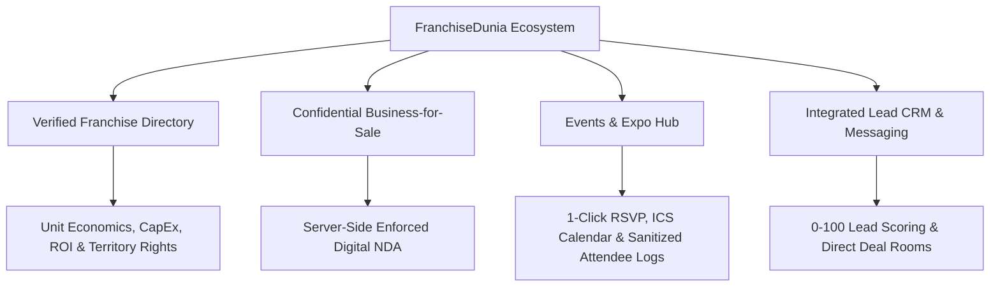
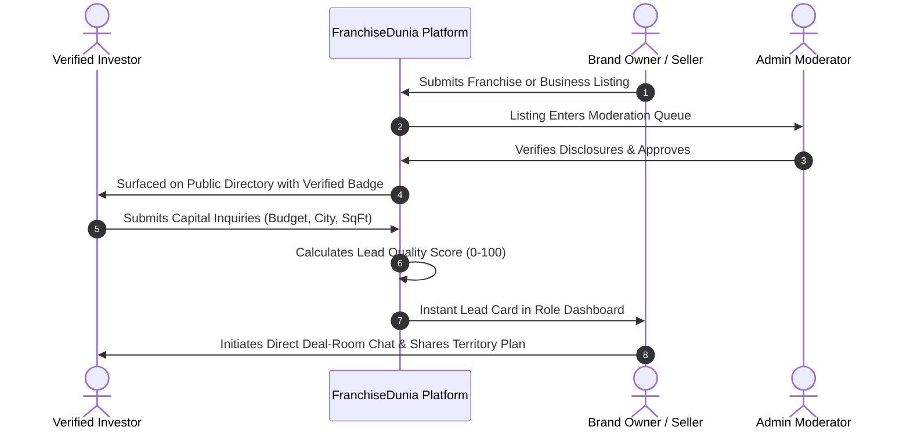
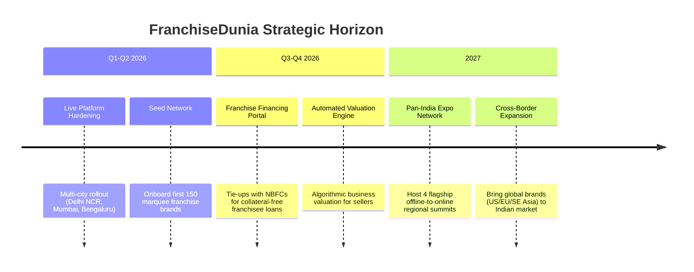

# FranchiseDunia — 12-Page Executive Business Pitch Deck
*The Operating System for India's Franchise & SME Investment Ecosystem*

---

## Slide 1: Cover & Vision

### FranchiseDunia (फ्रैंचाइज़ दुनिया)
> **Empowering India's Next Million Entrepreneurs Through Trust, Technology, and Capital.**

```
       ┌────────────────────────────────────────────────────────┐
       │                     FRANCHISEDUNIA                     │
       │     The Unified Marketplace for Franchise Expansion,   │
       │           SME Mergers & Acquisitions, and Expos        │
       └────────────────────────────────────────────────────────┘
```

* **Mission**: To replace chaotic broker networks and opaque classifieds with an enterprise-grade, institutional-quality marketplace that connects high-growth franchise brands, verified investors, business sellers, and industry expos.
* **Tagline**: *Invest. Expand. Acquire. All on One Verified Platform.*
* **Current Stage**: Production-Ready MVP deployed on Vercel & Render with live MongoDB Atlas cloud infrastructure.
* **Target Geographies**: India (Metro hubs + High-velocity Tier 2 & Tier 3 entrepreneurial corridors).

---

## Slide 2: The Problem

India's retail and services economy is experiencing unprecedented decentralization. Over 300,000 salaried professionals, NRIs, and regional operators are actively looking to deploy ₹10L–₹5Cr into proven business models. However, the existing market is plagued by three systemic failures:

| Pain Point | Current Industry Reality | Economic Consequence |
|---|---|---|
| **Opaque Brokerage Networks** | Traditional franchise brokers take 10%–20% unstandardized cuts and push underperforming brands with high commissions. | Poor match quality; 40%+ failure rate in franchisee first-year operations. |
| **Pervasive Deal Leakage & Fraud** | Existing classified portals leak confidential financials of running businesses, damaging goodwill and customer confidence. | Profitable business sellers refuse to list online due to lack of enforceable digital NDAs. |
| **Spam & Lead Fatigue** | Franchise brands receive hundreds of junk inquiries from unvetted leads with zero capital readiness. | Brand sales teams waste 70% of their operational bandwidth filtering unqualified leads. |
| **Fragmented Discovery** | Expos, offline trade shows, and brand discovery exist in isolated silos with zero post-event pipeline tracking. | Leads generated at multi-lakh rupee expos get lost in paper notebooks and untracked spreadsheets. |

---

## Slide 3: The Solution — The FranchiseDunia Ecosystem

FranchiseDunia combines the trust of an institutional investment platform with the consumer-grade UX of a modern digital marketplace.



* **Verified Supply**: Rigorous admin vetting of brand disclosures, master agreements, and unit economics before listings go live.
* **Confidential Deal Rooms**: Proprietary server-side NDA gatekeeping: sensitive financial statements, EBITDA, and tax documents are completely omitted from API payloads until a legal NDA is digitally executed.
* **Capital-Qualified Inquiries**: Algorithmic 0–100 lead scoring based on capital readiness, commercial space availability, and target timeline.
* **End-to-End Orchestration**: From discovery to NDA, direct messaging, and closing pipelines within a single role-based dashboard.

---

## Slide 4: Market Opportunity (TAM / SAM / SOM)

India's franchise economy is the 2nd largest globally and growing at a 30%+ CAGR, driven by rising consumer aspiration in non-metro cities and formalization of retail.

```
┌────────────────────────────────────────────────────────┐
│ TOTAL ADDRESSABLE MARKET (TAM)                         │
│ $140 Billion Indian Retail & Service Franchise Economy │
│ 5,000+ Active Franchisors | 2M+ Potential Franchisees  │
└───────────────┬────────────────────────────────────────┘
                │
┌───────────────▼────────────────────────────────────────┐
│ SERVICEABLE ADDRESSABLE MARKET (SAM)                   │
│ $4.8 Billion Digital Marketplace & Deal Advisory       │
│ F&B, Healthcare, EdTech, EV, Retail & Wellness         │
└───────────────┬────────────────────────────────────────┘
                │
┌───────────────▼────────────────────────────────────────┐
│ SERVICEABLE OBTAINABLE MARKET (SOM - Year 3)           │
│ $42 Million (₹350 Cr) Platform GMV & Revenue           │
│ 2,500 Listed Brands | 150,000 Qualified Investors      │
└────────────────────────────────────────────────────────┘
```

### Key Secular Tailwinds
1. **Tier 2/3 Expansion Surge**: Brands like Chai Point, Lenskart, and DTDC are deriving over 60% of new unit growth from non-metro cities.
2. **First-Gen Wealth Creation**: Rising appetite among corporate executives and family offices for passive and semi-absentee franchise ownership.
3. **SME Succession & M&A**: Hundreds of thousands of retiring SME owners across manufacturing, logistics, and retail seeking digital exit liquidity.

---

## Slide 5: Core Product Pillars

```
┌──────────────────────────┬──────────────────────────┬──────────────────────────┐
│   FRANCHISE HUB          │  BUSINESS-FOR-SALE       │   EXPOS & EVENTS         │
├──────────────────────────┼──────────────────────────┼──────────────────────────┤
│ • Verified badges        │ • Anonymous teaser cards │ • Expo listings & agenda │
│ • Investment brackets    │ • Server-side NDA gating │ • Speaker & exhibitor dir│
│ • Area/Space calculator  │ • P&L & EBITDA breakdown │ • Instant .ICS sync      │
│ • HMAC brochure tracking │ • Reason-for-sale vetting│ • Clean attendee CSV     │
└──────────────────────────┴──────────────────────────┴──────────────────────────┘
```

### 1. Verified Franchise Directory
* Clear categorization across F&B, Retail, Healthcare, Education, Fitness, and EV.
* Transparent capital requirements: Initial Franchise Fee, Setup Cost, Working Capital, and Expected ROI timeframe.
* Watermarked and HMAC-tracked investor pitch decks with zero unauthenticated distribution.

### 2. Confidential Business-for-Sale (M&A)
* Protects ongoing business operations: Public listings show only industry, region, and broad financial ranges.
* **Server-side NDA**: When an investor clicks "View Protected Financials", they must digitally sign the binding agreement (`v1.0`). Once signed, the server injects verified historical revenue, net margins, and asset audits.

### 3. Events & Summits Hub
* Aggregates national franchise expos, regional investor meetups, and virtual masterclasses.
* Features 1-click registration, instant Google Calendar/.ICS integration, and anti-formula injection attendee CSV exports for organizers.

---

## Slide 6: Enterprise Technology & Security Architecture

FranchiseDunia is built on an enterprise-grade, compliance-first tech stack designed to handle financial data and institutional deal flow securely.

```mermaid
graph LR
    subgraph Client Layer
        Web[Next.js 14 App Router]
        Mobile[Responsive PWA]
    end

    subgraph Security Gateway
        VercelEdge[Vercel Serverless Proxy]
        Rewrite[Same-Origin /api/ Rewrites]
        CSRF[Strict Origin Check]
        Helmet[Security Headers]
    end

    subgraph Microservices API
        Node[Express Node.js 20]
        Auth[httpOnly JWT Rotation]
        RBAC[5-Role IDOR Engine]
        Hasher[HMAC-SHA256 Tracker]
    end

    subgraph Storage
        Mongo[(MongoDB Atlas 7.0)]
    end

    Client Layer --> VercelEdge
    VercelEdge --> Rewrite
    Rewrite --> CSRF
    CSRF --> Helmet
    Helmet --> Microservices API
    Microservices API --> Storage
```

### Enterprise Security Safeguards
* **Zero LocalStorage Tokens**: Access tokens (15m) and Refresh tokens (7d) are stored exclusively in `HttpOnly`, `Secure`, `SameSite=Lax` cookies, neutralizing XSS credential theft.
* **Cryptographic Refresh Token Reuse Detection**: Refresh tokens are hashed per session; if an invalidated or rotated token is re-submitted, the entire session tree is instantly revoked.
* **Strict IDOR Prevention**: Granular role-based access control (RBAC) ensuring Brand Owners and Business Sellers can only access leads and listings they own.
* **Anti-Scraping & Injection Defense**: Parameter pollution (`hpp`), NoSQL injection sanitation (`express-mongo-sanitize`), and rate-limited auth endpoints.

---

## Slide 7: Business & Monetization Model

FranchiseDunia generates diversified, high-margin revenue through four synchronized monetization engines:

```
  ┌────────────────────────────────────────────────────────┐
  │ 1. SUBSCRIPTION TIERS (SaaS Listing Fees)              │
  │ • Free Tier: 1 Basic Listing, standard lead queue      │
  │ • Growth (₹14,999/mo): Verified badge, top 5 search    │
  │ • Enterprise (₹49,999/mo): Featured showcase & CRM pro │
  └───────────────────────────┬────────────────────────────┘
                              │
  ┌───────────────────────────▼────────────────────────────┐
  │ 2. QUALIFIED PAY-PER-LEAD (Performance Model)          │
  │ • Standard Inquiries: Included in subscription         │
  │ • Pre-Screened Capital Leads (Score > 80): ₹999 - ₹2,499│
  │ • Exclusive Area Franchise Leads: ₹4,999 per lead      │
  └───────────────────────────┬────────────────────────────┘
                              │
  ┌───────────────────────────▼────────────────────────────┐
  │ 3. BUSINESS M&A SUCCESS COMMISSIONS                    │
  │ • 1.5% to 3.0% deal closing success fee on business-   │
  │   for-sale transactions facilitated via digital NDA    │
  │ • Escrow and valuation advisory partner kickbacks      │
  └───────────────────────────┬────────────────────────────┘
                              │
  ┌───────────────────────────▼────────────────────────────┐
  │ 4. EVENT SPONSORSHIPS & TICKETING                      │
  │ • 5% ticketing commission on paid expo passes          │
  │ • Featured Exhibitor badge placements: ₹25,000/event   │
  └────────────────────────────────────────────────────────┘
```

---

## Slide 8: User Journey & Workflow Engine



### Seamless Workflows by Role
1. **Investor / Entrepreneur**: Filter by budget (e.g. ₹20L–₹50L), industry, and city; compare payback periods; sign instant digital NDAs; track all inquiries in one drawer.
2. **Franchise Brand Owner**: Track pipeline velocity (New → Under Review → Contacted → Converted); view brochure downloads with geographic heatmaps.
3. **Business Seller**: List confidential business without revealing trading name or exact premises; review buyer profiles before releasing private financials.
4. **Event Organizer**: Create expos; publish booth catalogs; export clean attendee data directly to sales teams.

---

## Slide 9: Competitive Landscape & Defensibility

| Feature / Metric | Traditional Offline Brokers | Legacy Classifieds (FranchiseIndia / Sulekha) | **FranchiseDunia** |
|---|---|---|---|
| **Digital NDA Gating** | ❌ Manual paper paperwork | ❌ None (Public deal leakage) | ✅ **Automated Instant Server-Enforced** |
| **Lead Quality** | ⚠️ Biased towards high cuts | ❌ High spam (unvetted scrape data) | ✅ **Algorithmic 0–100 Capital Scoring** |
| **Data Privacy & Security** | ❌ Zero compliance | ⚠️ Stored in plaintext databases | ✅ **Bank-Grade httpOnly Cookies & RBAC** |
| **Events Integration** | ❌ Completely disconnected | ⚠️ Static banner ads | ✅ **Native Ticketing, RSVP & Agenda Sync** |
| **Direct In-App Deal Room** | ❌ WhatsApp / Phone calls only | ❌ Opaque email forwarding | ✅ **Built-in Realtime Direct Messaging** |
| **Transparent Pricing** | ❌ 10–20% predatory commissions | ⚠️ Expensive lock-in directories | ✅ **Predictable SaaS + Performance Leads** |

### Our Defensible Moats
1. **Network Effects**: More verified brands attract higher-net-worth investors, creating deal density that competitors cannot replicate.
2. **Proprietary NDA Trust Graph**: Once an investor is verified and signs NDAs on FranchiseDunia, they conduct all future M&A exploration within the platform.
3. **Data Superiority**: Real-time city-level data on franchisee demand and commercial space availability.

---

## Slide 10: Go-To-Market (GTM) Strategy

```
┌────────────────────────────────────────────────────────┐
│ PHASE 1: SUPPLY-SIDE ACQUISITION (Months 1–6)          │
│ • Target top 200 franchisors in F&B, QSR & Retail      │
│ • Free 90-day Founder Tier for reputable brands        │
│ • Partnerships with Franchise Associations & Chambers  │
└───────────────┬────────────────────────────────────────┘
                │
┌───────────────▼────────────────────────────────────────┐
│ PHASE 2: INVESTOR LIQUIDITY & DEMAND (Months 7–12)     │
│ • Hyper-targeted LinkedIn & Google Search campaigns    │
│   (Keywords: "Best franchise under 30 lakhs Mumbai")   │
│ • Regional Investor Summits (Ahmedabad, Pune, Hyd)     │
│ • CA & Investment Banker Affiliate Referral Network    │
└───────────────┬────────────────────────────────────────┘
                │
┌───────────────▼────────────────────────────────────────┐
│ PHASE 3: EXPANSION & NETWORK FLYWHEEL (Year 2+)        │
│ • Launch "FranchiseDunia Capital" (Debt matching)      │
│ • Commercial Real Estate Landlord integrations         │
│ • Pan-India Franchise Awards & National Expo           │
└────────────────────────────────────────────────────────┘
```

---

## Slide 11: Unit Economics & 3-Year Financial Projections

### Unit Economics (Per Brand / Customer)
* **Average Customer Acquisition Cost (CAC)**: ₹8,500 (Blended paid & outbound)
* **Average Annual Contract Value (ACV)**: ₹78,000 (Subscription + Lead credits)
* **Lifetime Value (LTV)**: ₹195,000 (Based on 30-month average brand retention)
* **LTV / CAC Ratio**: **22.9x** (Exceptional unit-level capital efficiency)

### 3-Year Financial Model

| Metric | Year 1 (FY 2026-27) | Year 2 (FY 2027-28) | Year 3 (FY 2028-29) |
|---|---|---|---|
| **Active Listed Brands** | 350 | 1,200 | 3,500 |
| **Monthly Active Investors (MAU)** | 25,000 | 85,000 | 280,000 |
| **Annual Leads Processed** | 60,000 | 250,000 | 950,000 |
| **Subscription Revenue** | ₹1.8 Cr | ₹7.2 Cr | ₹22.5 Cr |
| **Lead Marketplace & Pay-per-Lead** | ₹1.2 Cr | ₹5.5 Cr | ₹18.0 Cr |
| **M&A Advisory & Success Fees** | ₹0.5 Cr | ₹2.8 Cr | ₹9.5 Cr |
| **Total Net Revenue** | **₹3.5 Cr ($420K)** | **₹15.5 Cr ($1.86M)** | **₹50.0 Cr ($6.0M)** |
| **Gross Margin %** | 82% | 85% | 88% |
| **EBITDA %** | 12% | 28% | 38% |

---

## Slide 12: Growth Roadmap & The Ask



### The Ask: Seed Round
* **Raising**: **₹4.0 Crore ($500,000 USD)** Seed Capital.
* **Target Valuation**: ₹24 Crore ($3.0M USD) Post-Money.

### Capital Allocation

```
┌────────────────────────────────────────────────────────┐
│ • 45% — Performance Marketing & Investor Acquisition   │
│ • 30% — Engineering, Mobile App (iOS/Android) & AI CRM │
│ • 15% — Enterprise Sales Team (Key Account Directors)  │
│ • 10% — Legal, Compliance, & Regulatory Escrow Engine  │
└────────────────────────────────────────────────────────┘
```

### Contact & Next Steps
* **Platform URL**: [https://franchise-dunia.vercel.app](https://franchise-dunia.vercel.app)
* **Backend API**: `https://franchisedunia-backend.onrender.com`
* **Repository**: `github.com/mohithreddy-git/FranchiseDunia`
* **Founding Team**: FranchiseDunia Executive Team
* **Inquiries**: `invest@franchisedunia.in`

---
*Confidential — Prepared for Accredited Investors, Strategic Partners, and Platform Stakeholders.*
